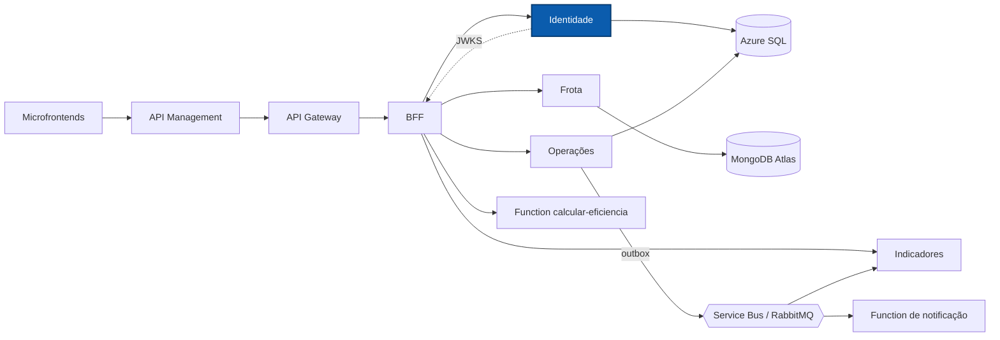

# NexFleet Identidade

Serviço de identidade do NexFleet: autentica usuários, emite tokens JWT assinados com RSA e administra as contas e os perfis de acesso.

[](https://github.com/mateusblm/nexfleet-identidade/actions/workflows/ci.yml)
[](https://hub.docker.com/r/mateusblm/nexfleet-identidade)


---

## Visão geral

O NexFleet é uma plataforma de gestão de frotas empresariais: veículos, motoristas, vínculos, abastecimentos, manutenções, painel de custos e uma visão consolidada de eficiência.

A **Identidade** é a autoridade de autenticação do produto. O BFF repassa a ela o login e a gestão de usuários; os demais serviços (BFF, Frota, Operações e Indicadores) validam os tokens com a chave pública publicada em `/.well-known/jwks.json`. Os dados ficam no **Azure SQL**, no schema `identidade`, acessado por um usuário de banco exclusivo do serviço.



## Funcionalidades

- Login por e-mail e senha (hash BCrypt) com emissão de JWT.
- Assinatura RSA e publicação da chave pública em JWKS (perfil `jwt-rsa`).
- Perfis de acesso `ADMINISTRADOR` e `GESTOR_FROTA`.
- Gestão de usuários exclusiva de Administrador ativo: criar, editar, consultar, listar, inativar e excluir definitivamente.
- Exclusão definitiva apenas de contas inativas e nunca da própria conta.
- E-mail único sem diferenciar maiúsculas e minúsculas.
- Criação opcional de um usuário inicial no ambiente local (perfil `local-seed`), sem nunca alterar a senha de uma conta existente.
- Readiness ligado ao banco: sem SQL disponível, o serviço responde `503` e não recebe tráfego.

## Arquitetura

**Clean Architecture + Vertical Slice.** Cada caso de uso é uma fatia em `br.com.nexfleet.identidade`, com as camadas `api`, `application` e `infrastructure`; o domínio compartilhado fica em `usuario/domain`.

| Fatia | Responsabilidade |
|---|---|
| `autenticar` | Login, usuário atual (`me`) e JWKS |
| `gerenciarusuarios` | Criar, editar, consultar, listar, inativar e excluir usuários |
| `consultarservico` | Informações do serviço |
| `usuario/domain` | Modelo de domínio (perfis de acesso) |

Pacotes técnicos: `config` (segurança, JWT, composição e usuário inicial local) e `observability` (correlação).

Regras verificadas pelo ArchUnit (`ArchitectureTest`):

- `domain` não depende de Spring, JPA nem das camadas `application`, `api` e `infrastructure`;
- `application` não depende de Spring, JPA, `infrastructure` nem `api`;
- `api` não acessa `infrastructure` nem JDBC diretamente;
- nenhuma classe importa código interno de outros serviços.

## API

Rotas internas do serviço. A aplicação web as consome pelo BFF, que as expõe em `/api/v1/auth/*` e `/api/v1/usuarios/*`.

| Método | Rota interna | Exposta pelo BFF como | Descrição |
|---|---|---|---|
| `POST` | `/api/v1/identidade/login` | `POST /api/v1/auth/login` | Login; devolve o JWT |
| `GET` | `/api/v1/identidade/me` | `GET /api/v1/auth/me` | Usuário autenticado |
| `GET` | `/api/v1/identidade/usuarios` | `GET /api/v1/usuarios` | Listar usuários |
| `GET` | `/api/v1/identidade/usuarios/{id}` | `GET /api/v1/usuarios/{id}` | Consultar usuário |
| `POST` | `/api/v1/identidade/usuarios` | `POST /api/v1/usuarios` | Criar usuário |
| `PUT` | `/api/v1/identidade/usuarios/{id}` | `PUT /api/v1/usuarios/{id}` | Editar e-mail, perfil e situação |
| `DELETE` | `/api/v1/identidade/usuarios/{id}` | `DELETE /api/v1/usuarios/{id}` | Inativar usuário |
| `DELETE` | `/api/v1/identidade/usuarios/{id}/definitivo` | `DELETE /api/v1/usuarios/{id}/definitivo` | Excluir usuário inativo |
| `GET` | `/.well-known/jwks.json` | — | Chave pública para validar tokens |
| `GET` | `/api/v1/identidade/info` | — | Informações do serviço |

O OpenAPI do serviço é publicado em `/v3/api-docs` e reunido na Swagger UI do Gateway: **[Swagger UI em produção](https://apim-nexfleet-homolog-ukzjodf42myfe.azure-api.net/swagger-ui.html)** (seletor "Identidade").

## Stack

| Camada | Tecnologia | Versão |
|---|---|---|
| Linguagem | Java | 21 |
| Framework | Spring Boot (Web MVC, Security, OAuth2 Resource Server, JDBC, Actuator) | 4.1.1 |
| Banco de dados | Azure SQL / SQL Server (`mssql-jdbc`) | — |
| Migrações | Flyway (`flyway-sqlserver`) | gerenciada pelo Spring Boot |
| Documentação | springdoc-openapi (`/v3/api-docs`) | 3.2.0 |
| Observabilidade | Micrometer + Prometheus | gerenciada pelo Spring Boot |
| Testes | JUnit 5, Testcontainers (SQL Server), ArchUnit | 5 / — / 1.4.1 |
| Build | Maven Wrapper | 3.9.16 |
| Contêiner | `eclipse-temurin:21-jre-jammy` | 21 |
| CI/CD | GitHub Actions → Docker Hub | — |

## Primeiros passos

### Pré-requisitos

- JDK 21 (o Maven vem pelo wrapper `./mvnw`)
- Docker, para os testes de integração (Testcontainers) e para executar a imagem

### Testes

```bash
./mvnw -B -ntp verify
```

### Executar com Docker

O serviço precisa de um SQL Server com o schema `identidade` e um usuário de banco já criados (o login do serviço não cria schemas) e de uma chave RSA privada em PEM.

```bash
docker run --rm -p 8081:8080 \
  -e SPRING_PROFILES_ACTIVE=jwt-rsa \
  -e DB_URL="jdbc:sqlserver://<host>:1433;databaseName=<banco>;encrypt=true" \
  -e DB_USER=<usuário> \
  -e DB_PASSWORD=<senha> \
  -e AUTH_JWT_PRIVATE_KEY=file:/run/secrets/identidade-jwt.pem \
  -v "$PWD/identidade-jwt.pem:/run/secrets/identidade-jwt.pem:ro" \
  mateusblm/nexfleet-identidade:v1.0.0
```

Para gerar a imagem a partir do código: `docker build -t mateusblm/nexfleet-identidade:local .`

### Ambiente completo

O produto inteiro (todos os serviços, SQL Server, MongoDB e RabbitMQ) sobe pelo repositório [nexfleet](https://github.com/mateusblm/nexfleet), que também cria o banco, os schemas, a chave RSA local e um usuário Administrador inicial:

```bash
git clone https://github.com/mateusblm/nexfleet.git && cd nexfleet
scripts/clonar-tudo.sh                                        # clona os demais repositórios ao lado
scripts/iniciar-local.sh                                      # gera o .env e a chave RSA local
docker compose -f compose.yaml -f compose.build.yaml up -d --build
scripts/seed-demo.sh                                          # dados de demonstração
```

## Configuração

| Variável | Descrição | Padrão |
|---|---|---|
| `PORT` | Porta HTTP | `8080` |
| `SPRING_PROFILES_ACTIVE` | `jwt-rsa` (assinatura RSA e JWKS); `local-seed` cria o usuário inicial | — |
| `DB_URL` | URL JDBC do SQL Server / Azure SQL | obrigatória |
| `DB_USER` | Usuário de banco do serviço | obrigatória |
| `DB_PASSWORD` | Senha do usuário de banco; segredo | obrigatória |
| `AUTH_JWT_PRIVATE_KEY` | Recurso Spring com a chave RSA privada em PEM (ex.: `file:/run/secrets/...`), com `jwt-rsa`; segredo | — |
| `JWT_SECRET` | Chave simétrica, usada só sem o perfil `jwt-rsa`; segredo | — |
| `LOCAL_USER_EMAIL` | E-mail do usuário inicial (`local-seed`) | — |
| `LOCAL_USER_PASSWORD` | Senha do usuário inicial (`local-seed`); segredo | — |
| `LOCAL_USER_PROFILE` | Perfil do usuário inicial (`local-seed`) | `GESTOR_FROTA` |

As migrações Flyway rodam no schema `identidade` com `create-schemas=false`.

## Ambiente em nuvem

| Recurso | Endereço |
|---|---|
| Aplicação | https://white-mushroom-0cadda010.3.azurestaticapps.net |
| API (Azure API Management) | https://apim-nexfleet-homolog-ukzjodf42myfe.azure-api.net |
| Swagger UI | https://apim-nexfleet-homolog-ukzjodf42myfe.azure-api.net/swagger-ui.html |
| AsyncAPI dos eventos | https://white-mushroom-0cadda010.3.azurestaticapps.net/docs/eventos/ |
| Imagem Docker | https://hub.docker.com/r/mateusblm/nexfleet-identidade |

A Identidade roda em Azure Container Apps, sem URL pública própria: é alcançada pelo BFF.

> Os serviços escalam a zero quando ociosos. A primeira requisição após um período de inatividade pode levar de 1 a 2 minutos.

## Testes

| Tipo | Exemplos | O que cobre |
|---|---|---|
| Unitários e de API | `AutenticarTest`, `GerenciarUsuariosTest`, `UsuariosHttpTest`, `RsaLoginHttpTest` | Casos de uso, permissões, login e emissão de JWT RSA |
| Integração (Testcontainers, SQL Server) | `JdbcUsuariosIT`, `IdentidadeHttpIT`, `LocalSeedConfigIT`, `ReadinessSemBancoIT` | Persistência real, e-mail duplicado, usuário inicial idempotente, readiness sem banco |
| Arquitetura (ArchUnit) | `ArchitectureTest` | Dependências entre camadas e isolamento entre serviços |

```bash
./mvnw -B -ntp verify     # testes de integração exigem Docker
```

O CI (`.github/workflows/ci.yml`) executa `verify` a cada push e pull request; em tags `v*`, publica `mateusblm/nexfleet-identidade:<tag>` e `:latest` no Docker Hub.

## Equipe

- Vinícius dos Reis Góes
- Mateus Burlamaqui
- Lucas Roussenq
- Erik Carvalho
